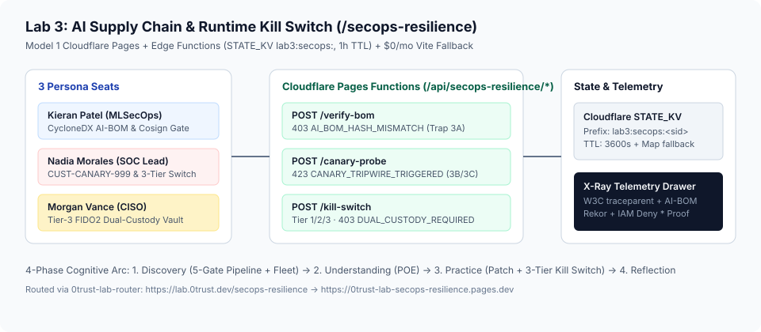
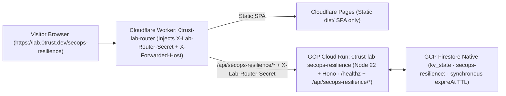

# Lab 3 Architecture: AI Supply Chain & Runtime Kill Switch (`0trust-lab-secops-resilience`)

Standalone Model 1 lab served at `https://lab.0trust.dev/secops-resilience` via `0trust-lab-router` (`c2pig/0trust.dev`), splitting static SPA hosting on Cloudflare Pages (`0trust-lab-secops-resilience.pages.dev`, `dist/` only) and API execution on **GCP Cloud Run** (`0trust-lab-secops-resilience`, Node 22 + Hono, `min_instance_count = 0`) backed by **GCP Firestore (Native mode)**.

## Architecture Overview

## Components & Contracts

1. **Persona Seats (3) & Modular UI (`src/pages/SecOpsResiliencePage.tsx` + `src/components/secops-resilience/`)**:
   - `mlsecops` (**Kieran Patel** — `MlSecOpsBomSeat.tsx`): CI/CD & CycloneDX AI-BOM Gate (Model Digest, System Prompt SHA-256, MCP Schema Hash, Sigstore Cosign OIDC).
   - `soc-commander` (**Nadia Morales** — `SocKillSwitchSeat.tsx`): Runtime War Room operating `CUST-CANARY-999` tripwire probes, runaway velocity guards (`>$50/min`), and the 3-Tier Kill Switchboard.
   - `ciso-cosigner` (**Morgan Vance** — `CisoDualCustodySeat.tsx`): Dual-custody hardware FIDO2 WebAuthn co-signer required for Tier 3 Global Fleet Circuit Breaker.

2. **Cloud Run API Endpoints (`server/app.ts` → synced `server/runtime.ts`, wrapping `functions/api/secops-resilience/`)**:
   - `server/app.ts` is a thin lab-specific route wrapper calling `createBaseLabApp` from the canonical synced `server/runtime.ts` (synced from `0trust.dev/templates/lab-runtime/` alongside `server/kvAdapter.ts`, `server/origin.ts`, `server/index.ts`, and the canonical multi-stage `Dockerfile`).
   - `GET /healthz`: Unauthenticated Cloud Run startup/liveness probe returning `200 { ok: true, lab: 'secops-resilience' }`.
   - `POST /api/secops-resilience/verify-bom`: Evaluates CycloneDX AI-BOM hashes and Cosign OIDC attestation; fails closed (`403 AI_BOM_HASH_MISMATCH`) on Trap 3A when hash pinning is enabled.
   - `POST /api/secops-resilience/canary-probe`: Detects `CUST-CANARY-999` exfiltration (Trap 3B), DLP-001..003 violations, and `>$50/min` runaway cost loops (Trap 3C) with `423 CANARY_TRIPWIRE_TRIGGERED`.
   - `POST /api/secops-resilience/kill-switch`: Executes `TIER_1_MCP_FREEZE`, `TIER_2_IAM_DENY` (AWS IAM `Deny *`), `TIER_3_GLOBAL_BREAKER` (fails closed `403 DUAL_CUSTODY_REQUIRED` without CISO FIDO2 assertion), and `RESET`.

3. **Security, State & Observability**:
   - **Direct Origin Blocking (`server/runtime.ts`)**: All `/api/*` requests fail closed with `403 FORBIDDEN_DIRECT_ORIGIN` unless `X-Lab-Router-Secret` matches in constant time (`crypto.timingSafeEqual`).
   - **Firestore Native State (`server/kvAdapter.ts`)**: Session-scoped `kv_state` documents (`secops-resilience:<encodedKey>`, `1h TTL`) with synchronous `expireAt.toMillis() <= Date.now()` expiry enforcement and local `MemoryKvAdapter` fallback in `npm run dev` (Vite `:5178` proxying `/api` to `127.0.0.1:8080`, zero GCP/Wrangler credentials required).
   - **Observability (`functions/api/_middleware.ts` + `_telemetry.ts`)**: Injects W3C `traceparent`, `X-Edge-Latency-Ms`, and `_telemetry` spans into JSON responses for `XRayTelemetryDrawer`, while redacting JWT signatures in `Authorization` and never exposing `X-Lab-Router-Secret` or `OTLP_AUTH_HEADER`.
   - **Infrastructure (`infra/terraform`)**: Composes `managed-infrastructure//modules/cloudflare-pages-lab` (static SPA) and `managed-infrastructure//modules/cloud-run-lab` (Cloud Run v2, least-privilege runtime SA, Secret Manager mounts). Remote state is declared in `infra/terraform/backend.tf` (`backend "gcs"`, bucket `0trust-dev-tfstate`, prefix `labs/secops-resilience`); local `*.tfstate*` and `.terraform/` are gitignored. Operators migrating from local state should provision the GCS state bucket once (Uniform Bucket-Level Access, versioning enabled, `public_access_prevention = "enforced"`) and run `terraform init -migrate-state`.
   - **Grafana Cloud Observability (OTLP `/v1/traces` + `/v1/logs`)**: `functions/api/_middleware.ts`, `functions/api/_telemetry.ts`, and `server/runtime.ts` export non-blocking OTLP/HTTP `/v1/traces` and `/v1/logs` spans via `waitUntil` with `OTEL_SERVICE_NAME=zerotrust-lab-secops-resilience` (resolved via `resolveServiceName(env)`), W3C `traceparent` 2-hop correlation (`0trust-lab-router` → `zerotrust-lab-secops-resilience`), pathname-only `http.target`, and `0trust.redaction_applied` JWT signature redaction. `OTLP_AUTH_HEADER` is mounted from GCP Secret Manager secret `grafana-otlp-auth-header`, and `XRayTelemetryDrawer.tsx` includes the `"Global Live Dashboard ↗"` link to `https://0trust.dev/observability`.

---

## Turnstile & 3-Minute Single-Session Lease Gate
- **Frontend Guard (`src/components/LabLeaseGuard.tsx`, re-exported via `src/shell/index.ts`)**: `src/App.tsx` wraps `<SecOpsResiliencePage>` with `<LabLeaseGuard labSlug="secops-resilience" labTitle="AI Supply Chain & Runtime Kill Switch">`. Fails closed while `status === null` and on non-localhost network/5xx/non-JSON errors (with a **Retry** button), and uses server-relative `retryAfterSec` countdowns without clock-skew polling loops.
- **Edge Enforcement (`0trust-lab-router` + `LabLeaseDO`)**: Queries `GET /api/lease/secops-resilience/status`, renders the explicit Cloudflare Turnstile widget (`0x4AAAAAAGVF1oWC5CsFWn-J`) when available, acquires an `HttpOnly; Secure; SameSite=Lax` lease cookie (`lab_lease_secops-resilience`) via `POST /api/lease/secops-resilience/acquire` (180s hard cap, 25 calls/lease, 200 calls/UTC day), shows a countdown lock screen when occupied, and exposes a floating `MM:SS + End Lab` pill while active.
- **Zero Engine Changes**: All existing same-origin `/api/secops-resilience/*` requests carry the `HttpOnly` lease cookie automatically; local development (`localhost` / `127.0.0.1`) and disabled lease configs pass through transparently.
- **Bounded Fallback & CI/CD Gates**: Unit-test / unbound-KV fallback maps in `functions/api/secops-resilience/*` are bounded (`MAX_EPHEMERAL_ENTRIES = 256`) with `1h` TTL eviction and are never written when `STATE_KV` is bound. `.github/workflows/ci.yml` gates PRs (`tsc --noEmit`, `tsc -p tsconfig.server.json --noEmit`, `npm test`, `npm run build`), and `.github/workflows/deploy.yml` gates both `deploy-pages` and `deploy-cloudrun` behind `needs: test-and-build`.
